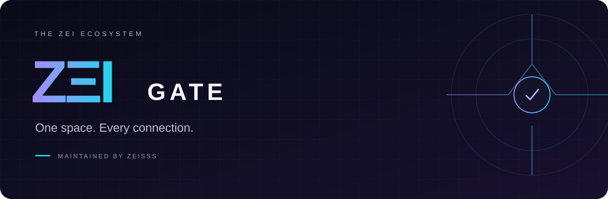

<div align="center">



### Satu pusat kendali. Semua layanan Telegram milikmu.

ForceSubs · Payment · Userbot

[](https://github.com/H3llnn/ZEI-Gate/actions)

[](LICENSE)

[**Mulai di laptop ↓**](#jalankan-di-laptop) · [**Dokumentasi**](docs/SUBGATE-LEGACY.md) · [**ZEI Userbot ↗**](https://github.com/H3llnn/ZEI-Userbot)

</div>

---

## Ekosistemmu, dalam satu tempat

**ZΞI Gate** menghubungkan bot induk dengan bot dan akun Telegram pengguna yang kamu izinkan. Nama bot anak mengikuti identitas Telegram masing-masing. Pengaturan sehari-hari tetap di bot; Mini App menjadi ruang untuk membuat layanan dan menghubungkan ulang akun.

| Layanan | Yang bisa kamu lakukan |
| :--- | :--- |
| **🔗 ForceSubs** | Bagikan konten melalui link dengan syarat bergabung, pemeriksaan ulang, dan penghapusan terjadwal. |
| **💳 Payment** | Jual akses channel/grup melalui QRIS, verifikasi pembayaran, dan kirim link akses. |
| **⚡ Userbot** | Hubungkan akun pribadi, atur prefix, dan gunakan 38 perintah dari akun sendiri. |

## Kendali yang jelas, alur yang rapi

| | |
| :--- | :--- |
| **🛡️ Izin per layanan** | Pemilik bot induk menentukan akses ForceSubs, Payment, Userbot, atau kombinasinya. |
| **✨ Ruang pembuatan** | Formulir Mini App bertema gelap untuk deploy dan koneksi ulang. |
| **🔐 Sesi terenkripsi** | OTP dan password 2FA tidak disimpan di database; formulir sementara memiliki batas waktu. |
| **🔄 Koneksi ulang terjaga** | Proses lama dipertahankan sampai pengganti terverifikasi dan siap. |

> **Status pengembangan:** 134 tes Gate dan 5 tes Userbot lulus pada pemeriksaan lokal. Aktivasi Telegram, login akun, dan transaksi nyata pada instalasi terbaru masih menunggu uji langsung. [Lihat hasil pemeriksaan](docs/STATUS.md).


## Jalankan di laptop

Letakkan dua folder berdampingan:

```text
ZEI-Project/
  ZEI-Gate/
  ZEI-Userbot/
```

Di terminal folder ZEI-Gate:

```powershell
python install.py
```


Untuk instalasi baru, salin sample_config.env menjadi config.env dan isi token bot induk, ID pemilik, SECRET_KEY. Buat kunci dengan .venv\Scripts\python.exe -m subgate.keygen.

Untuk pembaruan, cadangkan config.env dan seluruh folder data ketika bot berhenti. **Pertahankan SECRET_KEY dan DATA_DIR lama.** Jangan menimpa keduanya dengan contoh kosong. Jalankan RUN.cmd setelah konfigurasi siap.

## Aktifkan formulir pembuatan

```ini
CREATION_ENABLE=1
CREATION_PUBLIC_BASE=https://domain-milikmu.example
CREATION_BIND=127.0.0.1
CREATION_PORT=8081
```


Domain HTTPS diarahkan melalui reverse proxy ke port 8081. Ini untuk Mini App, bukan kebutuhan webhook Payment. Pembayaran sederhana tetap tidak membutuhkan tunnel. Untuk uji laptop sementara dapat memakai tunnel ke port **8081**; jika alamat berubah, perbarui konfigurasi dan restart. Jangan menggunakan alamat tunnel lama yang sudah berhenti.

Bot induk menampilkan tombol Buka Ruang Pembuatan ketika alamat tersebut diaktifkan. Pembuka wajib dari tombol Telegram; membuka URL biasa tidak memberi akses. Atur inline mode melalui BotFather /setinline untuk bot induk agar .help dapat menampilkan tombol. Login akun dan kode OTP dilakukan sendiri oleh pemilik melalui formulir.

## Docker / VPS

Jalankan docker compose up -d --build di folder ZEI-Gate. Image memasang runtime Userbot dari commit yang dipin; build context hanya folder Gate. Port host hanya terikat localhost. Pasang HTTPS reverse proxy di depan port 8081. Pada pembaruan Docker, pertahankan nama proyek Compose lama dengan opsi -p agar volume subgate-data lama tetap digunakan; jangan menjalankan down -v. Cadangkan volume data dan SECRET_KEY bersama-sama; kehilangan kunci membuat sesi lama tidak dapat dibaca.

Proses Userbot terpisah per akun, tanpa shell/eval dan tanpa modul pihak ketiga yang dimuat otomatis. Pemisahan proses bukan sandbox OS; pengelola server tetap memiliki akses ke penyimpanan. Jalankan hanya di server yang kamu percaya.

## Pengujian

```powershell
.venv\Scripts\python.exe -m unittest discover -s tests -v
```


Tes lokal memakai Telegram dan pembayaran tiruan, tidak membuat pembayaran nyata atau login akun pengguna. Hasil dan batas pemeriksaan terdapat pada [status rilis](docs/STATUS.md).

## Lisensi

GPL-3.0. Nama produk baru tidak menghapus hak cipta kode terdahulu. Lihat LICENSE dan THIRD_PARTY_NOTICES.md. Sumber dan atribusi pustaka tercatat pada THIRD_PARTY_NOTICES.md masing-masing proyek.

## Menyatukan instalasi lama

Jika ForceSubs dan Payment masih berjalan dari folder berbeda tetapi memakai bot induk yang sama,
hentikan keduanya dan siapkan cadangan konsisten dari config.env dan subgate.sqlite masing-masing.
Gunakan python -m subgate.merge_install --forcesubs CADANGAN_FORCE --payment CADANGAN_PAYMENT --output FOLDER_BARU.
Tool menolak bot induk/pemilik berbeda, mempertahankan sumber, menyatukan izin, dan mengenkripsi ulang data Payment
menggunakan kunci ForceSubs. Tujuan harus baru; jangan arahkan ke instalasi aktif.

Jika bot yang sama pernah beralih dari ForceSubs ke Payment dengan pemilik yang sama, menu Payment dipertahankan;
link konten lama tetap dilayani melalui kompatibilitas khusus dan jadwal penghapusannya tetap berjalan.
Paket akses serta riwayat transaksi tetap disimpan. Cadangan sumber merupakan jalur rollback.

---

<div align="center">

**ZΞI PROJECT** · Maintained by **Zeisss**

Built around your Telegram workflow.

</div>
